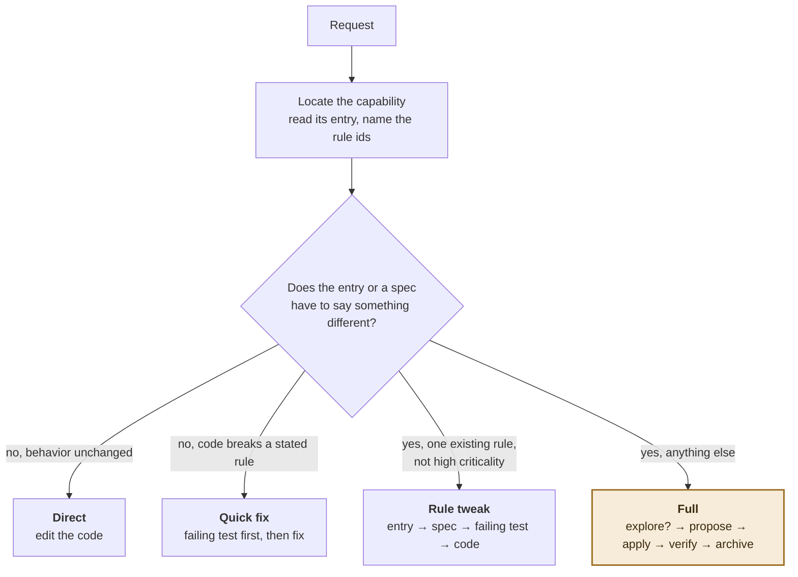
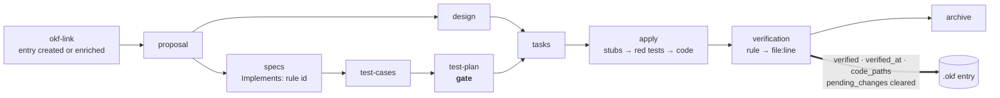

# Workflow at a Glance

The map, not the manual. The rules themselves live in `AGENTS.md` and in the
`okf-gated-feature` schema.

## The one idea

| Layer | Lives in | Lifetime |
| --- | --- | --- |
| **Knowledge** - terms, actors, rules with `BR-<slug>` ids | `.okf/features/<capability>.md` | Permanent, edited in place |
| **Requirements** - requirements, scenarios | `openspec/specs/<capability>/spec.md` | Permanent, changed through deltas |
| **A change** - proposal, delta specs, tests plan, tasks | `openspec/changes/<change-id>/` | Ends at archive |

A rule is written once, in the knowledge entry, with a stable id. Specs, tests,
commits and verification evidence quote the id, never the wording - as
`order-limit/BR-max-items` wherever the capability is not obvious.

## Every request starts with a route



Ties go to the heavier route. A short route that stops fitting - an existing
assertion has to change, the entry is silent, the diff reaches another
capability - escalates on the spot.

## The full route



OpenSpec refuses `apply` until `okf-link`, `test-plan` and `tasks` exist. The
verification pass is what moves an entry to `verified`, and only with evidence
in the code behind each rule.

## When the entry and the code disagree

| Verdict | Meaning | Action |
| --- | --- | --- |
| `match` | Code does what the rule says | Nothing |
| `okf-gap` | Code right, entry stale | Update the entry |
| `code-gap` | Entry right, code wrong | **Fix the code** - never sync the entry to a bug |
| `conflict` | Genuine disagreement | Ask a human; `needs-revision` only if undecidable |

Order of repair when a rule turns out wrong:

```text
OKF entry  →  spec  →  test  →  code
```

## What holds it together

Nothing runs in CI and nothing blocks. Four things do the work:

- **OpenSpec's own gates** - `apply` needs the knowledge link and a test plan.
- **The routes in `AGENTS.md`** - every request is placed before code is written,
  and the route is stated in one line and in the commit message.
- **`node .okf/check.mjs`** - warns about drift: a citation to a rule that does
  not exist, a pending change already archived, a `verified` entry with no
  `code_paths`. In Claude Code a hook runs it after every edit under `.okf/` or
  `openspec/` and hands the warnings to the agent, which fixes what is real.
- **Review** - a reviewer compares the stated route with the diff: Direct and
  Quick fix leave `.okf/` alone, a Rule tweak changes exactly one `BR-<slug>`, the
  full route has a change directory.
